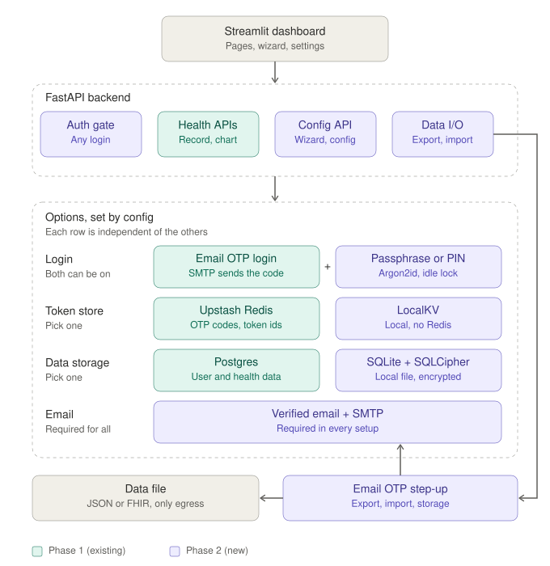

# HealthTally

HealthTally is a personal project for recording and tracking health data over time, with metric input, goal setting, trend charts, and data export. It is also a technical sandbox for backend architecture, authentication, and health data standards.

The target use case is simple. Download the code and run it on any screen you like, with the data staying in your own hands.

> **We are here:** Phase 1 is done, and we are now moving into Phase 2, which revamps the login and structure for a local-first, local-preferred strategy and adds import and export with FHIR.

---

## Product direction

HealthTally is for people who care about health privacy. Whether data stays local is the user's choice, and each user decides how far to go.

- **Local-first and local-only are options.** Login, token storage, and data storage are chosen independently. A user can log in purely locally with a passphrase, or prefer the cloud-assisted email OTP login.
- **A verified email is required in every setup.** It is the second layer that protects export, import, and storage changes. The only network use in the core product is sending these codes, and they contain no health data.
- **Third-party integrations break the local-only promise, by design.** Heads-up features built on third-party APIs (Phase 2 or Phase 3) exchange data with external services, so a feature that uses them is no longer local-only. The intent is opt-in, off by default, enabled per feature, with a clear statement of what is sent. Everything else stays as local as the user chose.

---

## Project Planning

| Phase | Description |
|-------|-------------|
| **Phase 1** (Sep 2025) | Core features, JWT + email OTP authentication, architecture setup |
| **Phase 2** (Current) | Local-first revamp (passphrase login, SQLite + SQLCipher, setup wizard, settings page), import and export with FHIR |
| **Phase 3** (Planned) | MQTT device ingest, pet health tracking, third-party API integration (may start in Phase 2) |

---

## Phase 1 (done)

Phase 1 (formerly CarePilot) covered:

- Health data input, record review, goal setting, trend charts
- Email OTP login with JWT, Streamlit + FastAPI on PostgreSQL
- Unit tests and multi-environment Docker setup

All of it stays available in Phase 2.

> Phase 1 is pure hand-coding, written without AI assistance.

---

## Phase 2 (current)

> From Phase 2 on, Claude Code is part of the development flow. The author makes the decisions and reviews the output.

Two workstreams make the structure more solid, more secure, and more local, with real data portability.

### 1. Revamp login and structure for local-first

Login, token storage, and data storage become independent options, chosen in a first-run setup wizard and changeable later from a settings page. Both login methods can be on, while token store and data storage take one each. The options are listed in the [Tech Stack](#tech-stack-and-architecture).

- **Setup wizard** with presets Local vault, Cloud connected (the Phase 1 setup), Hybrid, and Advanced. It is reachable from localhost only, needs a one-time code, then closes.
- **Settings page** to change login, passphrase, email, token store, and data storage, plus export and import.
- **Encrypted storage** derives its key from the passphrase, so Email OTP cannot replace the passphrase when encryption is on. Without the recovery key, a forgotten passphrase means the data is lost.
- **Hardening** adds shorter token lifetime in local modes, attempt limits with backoff, and idle auto-lock.

### 2. Import and export with FHIR

Health data can be exported and imported as JSON or a FHIR Bundle (Observation resources for blood pressure, heart rate, temperature, SpO2, and glucose, with codes checked against the official tables). Export is the only path where data leaves the system. Sensitive actions need a second layer.

| Verification | Actions |
|---|---|
| Email OTP | Export, import, switch data storage, change email |
| Current passphrase | Change passphrase, change login methods |
| Active session only | Switch token store |

Where no passphrase exists (email-only setup), the passphrase tier falls back to Email OTP. The proposed defaults, not final, are an OTP valid for 5 minutes with 3 attempts, then a 30 minute lock.

---

## Tech Stack and Architecture

🟢 marks Phase 1 and 🟣 marks Phase 2. Phase 2 is built on top of Phase 1, and nothing in the Phase 2 rows is implemented yet.

| Category | Technologies |
|----------|--------------|
| **Frontend** | 🟢 Streamlit <br> 🟣 Setup wizard, settings pages |
| **Backend** | 🟢 FastAPI, SQLAlchemy, Pydantic, SMTP <br> 🟣 Config service with runtime engine selection |
| **Database** | 🟢 PostgreSQL, Alembic <br> 🟣 SQLite + SQLCipher as an encrypted local option |
| **Auth** | 🟢 JWT, email OTP <br> 🟣 Passphrase or PIN login with Argon2id key derivation, email OTP step-up for sensitive actions |
| **Token store** | 🟢 Redis (Upstash) <br> 🟣 LocalKV |
| **Data analytics** | 🟢 pandas, matplotlib |
| **Standards** | 🟣 FHIR (HL7) Bundle import and export |
| **DevOps** | 🟢 uv, Makefile, multi-env configuration <br> 🟢 Docker (optional) |
| **Testing** | 🟢 pytest <br> 🟣 Tests for auth modes and export |
| **Development** | 🟢 Hand-coded <br> 🟣 Claude Code in the development flow |

Candidate libraries for the new parts, to be confirmed when implementing, are `argon2-cffi`, `sqlcipher3`, and `fhir.resources`.



Swimlane and flow diagrams (Mermaid, rendered by GitHub) are in [docs/diagrams.md](docs/diagrams.md).

---

## Quick start

The main way to run HealthTally is with [uv](https://docs.astral.sh/uv/) and `make`. Docker is optional.

**Requirements:** [uv](https://docs.astral.sh/uv/getting-started/installation/). It installs Python 3.12 and every dependency inside the project's `.venv`, so nothing is installed system-wide.

```bash
make setup    # install dependencies exactly as pinned in uv.lock
make dev      # backend on :8000, dashboard on :8501
make test     # run the tests
```

Settings are read from `.env.development` (or `.env.<ENV>`). These files are git-ignored, so create your own and never commit it. The dashboard finds the API through the `API_URL` environment variable (default `http://localhost:8000`). Run `make help` to see every target.

### Docker (optional)

If you already have Docker, you can run the backend and the dashboard in containers instead:

```bash
make docker-up      # or: docker compose --profile development up --build
make docker-down
```

The image installs from `uv.lock`, runs as a non-root user, and does not contain your `.env` files. Ports are bound to `127.0.0.1` only.

---

## Project Structure

```
healthtally/
├── backend/                      # FastAPI backend
│   ├── alembic/                  # Migrations
│   ├── config/                   # Settings
│   ├── models/                   # ORM models
│   ├── routers/                  # API routes (auth, chart, goal, history, profile, record)
│   ├── schemas/                  # Pydantic schemas
│   ├── services/                 # JWT, OTP, Redis, SMTP, MQTT (placeholder)
│   ├── templates/emails/         # OTP email template
│   ├── db.py                     # DB session and engine
│   └── main.py                   # Entry point
├── dashboard/                    # Streamlit frontend
│   └── pages/                    # login, register, verify, home, daily, history, stats, profile, logout
├── docs/                         # Phase 2 design diagrams
├── tests/                        # Backend tests
├── Dockerfile                    # Optional
├── docker-compose.yml            # Optional
├── .dockerignore
├── Makefile                      # Main entry: setup, dev, test, lint
├── pyproject.toml
├── pytest.ini
├── uv.lock
├── LICENSE                       # MIT License
└── README.md
```
