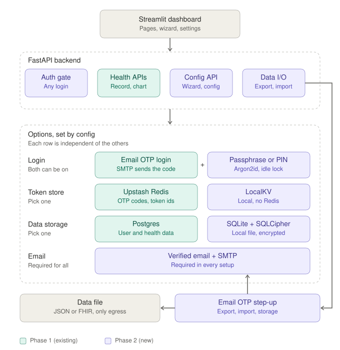
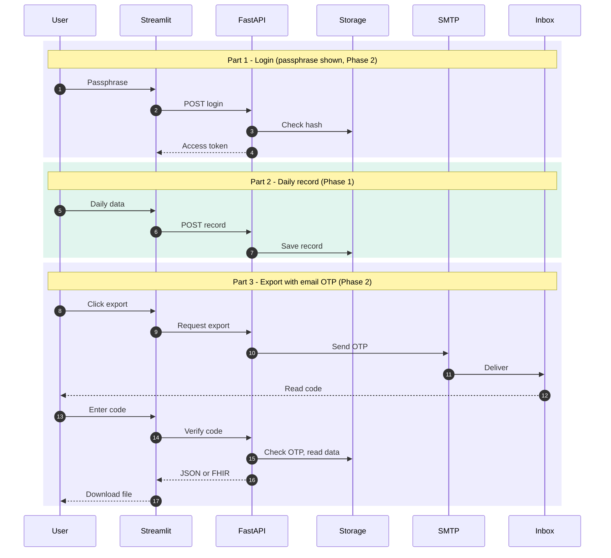
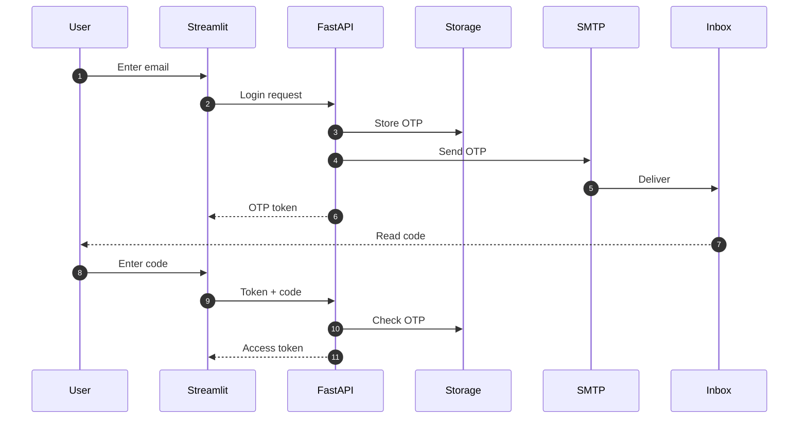
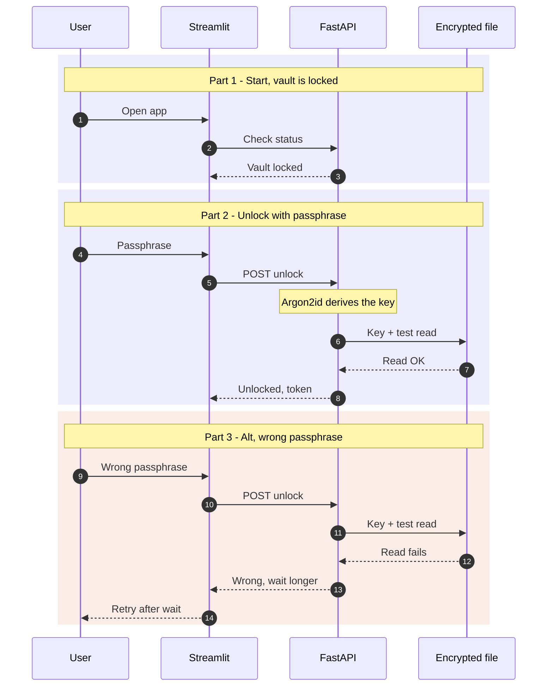
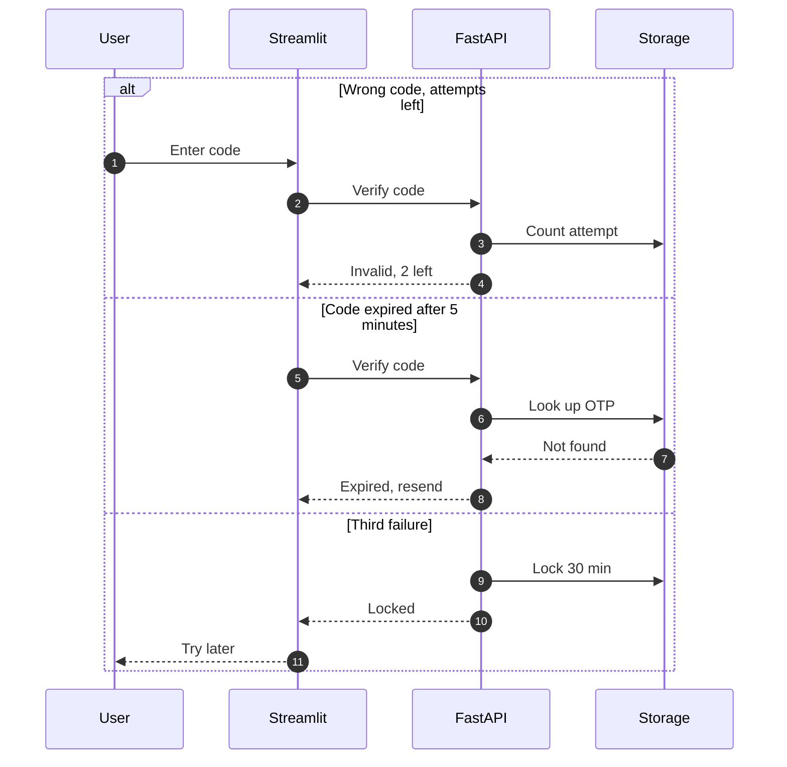
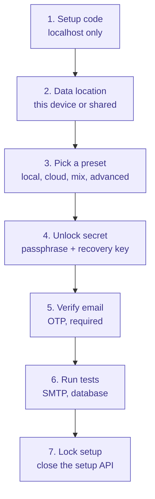
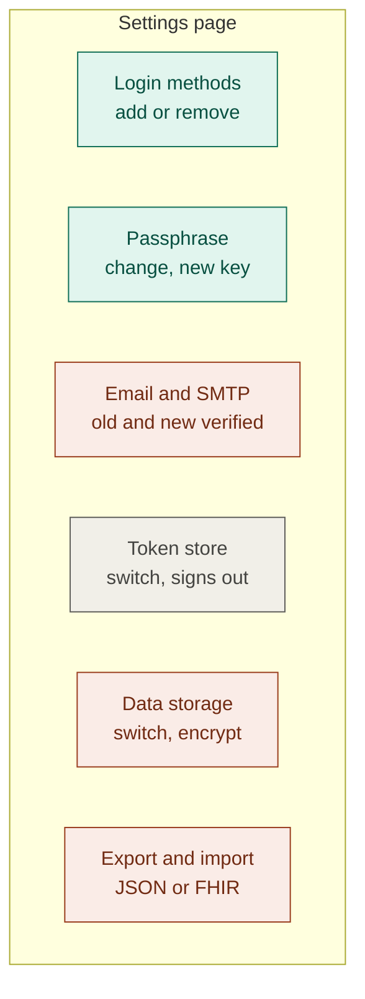

# CarePilot diagrams (Phase 2 design)

Status: draft for review. These describe the Phase 2 target, not what is implemented today.
Phase 1 is the existing flow. Phase 2 is what is new.

The overall block diagram is a separate file: [architecture.svg](architecture.svg).

Contents

1. [Swimlane: login, daily record, export](#1-swimlane-login-daily-record-export)
2. [Swimlane: email OTP login (Phase 1)](#2-swimlane-email-otp-login-phase-1)
3. [Swimlane: encrypted vault unlock](#3-swimlane-encrypted-vault-unlock)
4. [Swimlane: export OTP failure paths](#4-swimlane-export-otp-failure-paths)
5. [Flow: first-run setup wizard](#5-flow-first-run-setup-wizard)
6. [Structure: settings page and verification tiers](#6-structure-settings-page-and-verification-tiers)

---

## 1. Swimlane: login, daily record, export

Purple blocks are new in Phase 2, green is the existing Phase 1 flow. The three parts below are steps in one session and are not project phases. SMTP and Inbox are separate lanes on purpose: the OTP leaves the system through SMTP and only then reaches the user.

---

## 2. Swimlane: email OTP login (Phase 1)

The existing flow: `login-request` returns an OTP token, `verify` takes the token plus the code and returns the access token.

Compare with the passphrase login in diagram 1: four steps, no SMTP, no network needed.

---

## 3. Swimlane: encrypted vault unlock

Applies when data storage is SQLite + SQLCipher. The service starts locked. A wrong passphrase fails at the read test, because the key is derived from the passphrase. No password hash is stored for verification.

---

## 4. Swimlane: export OTP failure paths

The numbers (5 minutes, 3 tries, 30 minute lock) are proposed defaults, not final.

---

## 5. Flow: first-run setup wizard

Presets

| Preset | Login | Token store | Data storage |
|---|---|---|---|
| Local vault | Passphrase | LocalKV | SQLite + SQLCipher |
| Cloud connected (the Phase 1 setup) | Email OTP | Upstash | Postgres |
| Hybrid | Passphrase + Email OTP | LocalKV | SQLite (encryption optional) |
| Advanced | pick each | pick each | pick each |

Rules: choosing encrypted storage forces passphrase login, because Email OTP cannot derive the key. Every preset requires a verified email. Setup binds to localhost only and needs a one-time code printed by the server, then the setup API closes.

---

## 6. Structure: settings page and verification tiers

| Colour | Verification needed | Sections |
|---|---|---|
| Orange | Email OTP | Email and SMTP, data storage, export and import |
| Green | Current passphrase | Login methods, passphrase |
| Grey | Active session only | Token store |

Where no passphrase exists (email-only setup), the "current passphrase" tier falls back to Email OTP.
